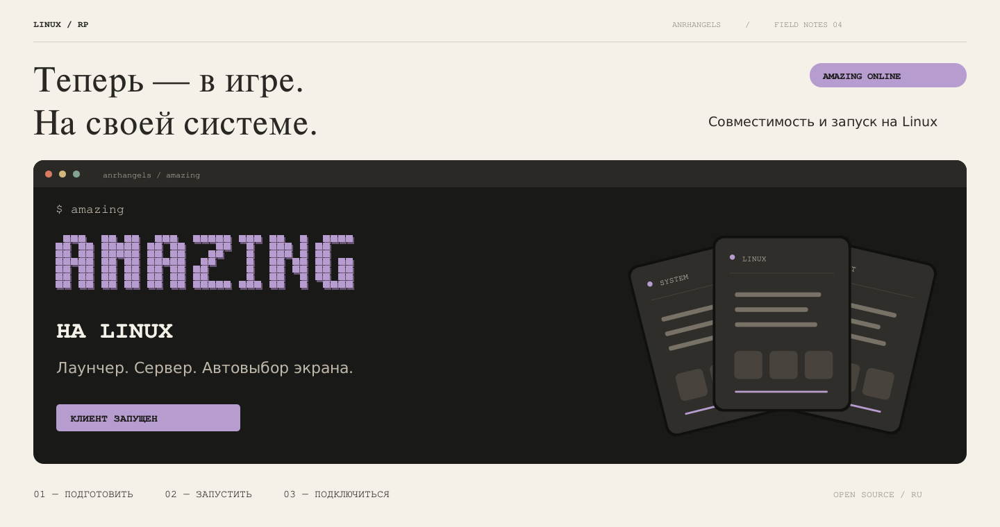
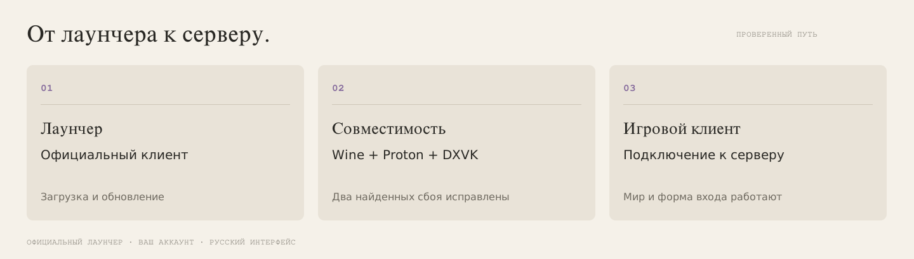
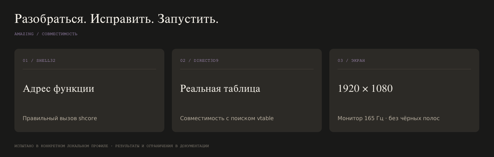

<p align="center"></p>

<p align="center">
  <a href="#установка"><b>Установить игру</b></a> ·
  <a href="#запуск">Запустить</a> ·
  <a href="docs/troubleshooting.md">Нужна помощь</a> ·
  <a href="docs/research-2026-11-09.md">Как это работает</a>
</p>

```text
LINUX RP SERIES / 04
AMAZING ONLINE НА LINUX
Лаунчер · игровой клиент · сервер · удобный запуск
```

**Amazing Online запускается на Linux.** Работают официальный лаунчер, подключение к GREEN, трёхмерный мир, русский интерфейс и форма входа. Для запуска подготовлены скрипты, исправления совместимости и автоматический выбор экрана.

**Единый установщик — [`install-amazing-rp.sh`](install-amazing-rp.sh).** Он готовит Linux-компоненты, Wine-окружение, .NET, PowerShell, графические библиотеки, официальный лаунчер и ярлык. Сам игровой клиент скачивается в официальном лаунчере, а аккаунт остаётся вашим.

<a id="установка"></a>

## 01 / Установить игру

Нужны Linux x86_64, интернет, драйвер видеокарты с Vulkan и свободное место для клиента. Подготовка системных пакетов предусмотрена для Arch / CachyOS / Manjaro, Ubuntu / Mint / Debian, Fedora и openSUSE.

### Через Git

Откройте терминал и выполните:

```bash
git clone https://github.com/anrhangels/linux-amazing-rp.git "$HOME/linux-amazing-rp"
cd "$HOME/linux-amazing-rp"
bash install-amazing-rp.sh
```

Запускайте без `sudo` перед скриптом: права будут запрошены только для системных пакетов. Подтвердите показанный план и дождитесь завершения установки. Если официальный установщик сам открыл лаунчер, закройте его окно, чтобы скрипт продолжил настройку.

### Через ZIP

1. **[Скачайте архив проекта](https://github.com/anrhangels/linux-amazing-rp/archive/refs/heads/main.zip)** или нажмите **Code → Download ZIP**.
2. Распакуйте его и откройте папку `linux-amazing-rp-main`.
3. Откройте терминал в этой папке и выполните:

```bash
bash install-amazing-rp.sh
```

Git для этого способа не нужен. Сохраняйте все файлы проекта вместе: главный скрипт использует входящие в него компоненты.

[Подробная установка и параметры →](docs/installation.md)

<a id="запуск"></a>

## 02 / Открыть Amazing

После установки найдите **Amazing RP** в меню приложений или выполните:

```bash
~/.local/bin/amazing
```

В официальном лаунчере дождитесь загрузки клиента, выберите сервер и нажмите **«Играть»**. Затем войдите в свой аккаунт или создайте персонажа.

Повторно устанавливать всё перед каждой игрой не нужно. Если рабочая установка уже найдена, установщик сохраняет компоненты и данные и обновляет команды запуска.

<p align="center"></p>

## 03 / Что делает установщик

| Задача | Что выполняется |
| :--- | :--- |
| Подготовить Linux | Установка Flatpak, необходимых инструментов и шрифтов |
| Подготовить окружение | Faugus, проверенная GE-Proton 11-11 и UMU в отдельном профиле |
| Добавить компоненты Windows | Native .NET Framework 4.8, VC++, DirectX 9 и подписанные сборки PowerShell 5.1 |
| Получить официальный лаунчер | Загрузка AmazingSetup с официального источника и настройка AmazingService |
| Исправить совместимость | Сборка локальных адаптаций shell32 и DXVK с проверкой настоящих API |
| Удобно открывать игру | Команда `amazing`, ярлык и автоматическая настройка окна |
| Сохранить существующие данные | Проверка префикса, резервные копии и отказ от перезаписи неизвестных файлов |

Компоненты со стабильными версиями проверяются по контрольным суммам. Файлы игры, готовые Wine-префиксы, пароли и сторонние DLL в репозитории не распространяются.

## 04 / Экран без лишних настроек

Скрипт выбирает монитор, где открывается игра, и разворачивает игровое окно. В нашей конфигурации это **1920×1080 на внешнем мониторе около 165 Гц**, без чёрных полос справа и снизу.

В Hyprland запуск направляется на рабочий стол 1. Выбранный выход временно становится основным в Xwayland; при завершении прежний выбор восстанавливается. Это общий признак X11, его могут учитывать другие X11-приложения. Физическое разрешение, масштаб, расположение и частота мониторов не изменяются.

[Подробности настройки экрана →](docs/displays.md)

<p align="center"></p>

## 05 / Что исправлено

**shell32 → shcore.** Клиент напрямую вызывал строку перенаправления `CommandLineToArgvW` вместо функции. Локальная обёртка вызывает настоящую реализацию API; её поведение проверено на аргументах с кириллицей, кавычками и пробелами.

**Direct3D9.** Старый механизм поиска таблицы устройства не находил ожидаемую последовательность в DXVK и читал за пределами DLL. Добавлена совместимая запись поиска, указывающая на настоящую таблицу графического устройства. Адрес проверяется через стандартный `CreateDevice` и привязан к конкретной сборке DXVK.

Игровой `aggmain.asi` не патчится. Общий Proton других игр сохраняется: используется отдельный вариант runtime с локальной графической библиотекой.

[Подробный разбор и результаты →](docs/research-2026-11-09.md)

## 06 / Проверить или обновить

Показать состояние без установки и изменений:

```bash
bash install-amazing-rp.sh --check
```

Посмотреть план:

```bash
bash install-amazing-rp.sh --plan
```

Обновить скачанный проект:

```bash
git -C "$HOME/linux-amazing-rp" pull --ff-only
cd "$HOME/linux-amazing-rp"
bash install-amazing-rp.sh
```

Перед повторной настройкой закройте Amazing и лаунчер. Не очищайте префикс или папку игры вручную. Обновления самого клиента получает официальный лаунчер.

## 07 / Документация

| Руководство | Что внутри |
| :--- | :--- |
| [Установка](docs/installation.md) | Git и ZIP, системные пакеты, параметры и повторный запуск |
| [Экран](docs/displays.md) | Монитор, полноэкранный режим и возврат настроек |
| [Решение проблем](docs/troubleshooting.md) | Ошибки установки, журналы, повторная настройка и восстановление |
| [Исходники совместимости](tools/compat-20261109/README.md) | Скрипты запуска, API-пробы, генераторы адаптаций и откат |
| [Результаты 9 ноября](docs/research-2026-11-09.md) | Запуск клиента, подключение и две найденные причины сбоев |
| [Архив исследований](docs/research-2026-11-08.md) | Предыдущие эксперименты с зависимостями, службами и Wine |

## Авторство

Неофициальный проект **anrhangels**, не связанный с разработчиками Amazing Online. Лаунчер загружается с [официального сайта](https://amazing-online.com/).

Скрипты, документация и собственная графика — [MIT](LICENSE). Права на игру, Microsoft-компоненты, Wine, Proton и DXVK принадлежат их правообладателям. При исследовании и подготовке проекта использовался OpenAI Codex.
